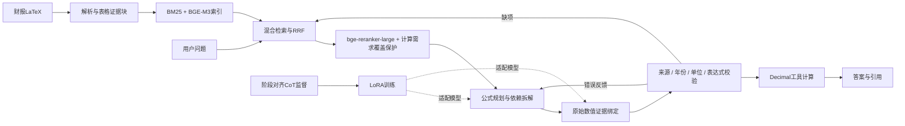

# FinCalc-Agent

**面向中文财报复杂计算的问答智能体**

Qwen3.5-9B · Agentic RAG · 多步规划 · Decimal工具计算 · LoRA

将中文财报中的跨表数值检索、公式规划和证据绑定组织为可追溯的单Agent工作流。
模型负责规划和绑定，程序负责来源、期间、单位与表达式校验及确定性计算；
缺项触发定向补检索，错误反馈驱动受限修复。

## 系统架构



## 主要能力

- **检索与补全**：BM25＋BGE-M3＋RRF＋bge-reranker-large，保留表头、年度、指标行与单位，保护计算所需证据。
- **规划与工具调用**：区分原始输入与派生指标，按依赖计算；校验失败时保留已通过绑定并定向修复。
- **阶段监督LoRA**：一题一条完整样本，规划、绑定、修复阶段显式对齐运行接口；使用completion-only loss。
- **可复核评测**：答案准确率、Numeric EM、计划结构可用率、需求证据召回及绑定完整度；精确缓存和指纹校验支持断点续评。

## 快速开始（无需GPU）

Python 3.12，在仓库根目录执行：

```bash
python -m venv .venv
# Linux/macOS: source .venv/bin/activate
# Windows PowerShell: .venv\Scripts\Activate.ps1
python -m pip install -r requirements.txt
python examples/decimal_demo.py
python -m unittest discover -s tests -v
python scripts/check_release.py
```

示例采用虚构证据，输出营业利润率0.15。单元测试不联网、不调用模型；需要完整语料或模型文件的集成检查明确跳过。

## 完整运行

1. 按[运行指南](docs/QUICKSTART.md)准备语料、BGE-M3、reranker与Qwen模型。
2. 运行解析、切块、索引及R1上下文导出。
3. 使用`scripts/train_lora.py`训练，或加载自己的adapter。
4. 启动BF16服务，再用`scripts/run_rag.py`生成，最后用`scripts/evaluate.py`离线计分。

本仓库发布代码、配置、虚构示例及结果摘要。完整训练集、第三方语料、索引、权重和运行日志在本地准备，不包含在Git仓库中。

## 记录的实验结果

| 指标 | 对照结果 | 当前结果 |
|---|---:|---:|
| 数值需求Recall@10 | 原重排链路58.86% | R1链路71.43% |
| 证据块MRR@10 | 原重排链路0.3645 | R1链路0.6446 |
| 固定规划需求绑定完整率 | 关闭工作流14.72% | 开启工作流55.21% |
| Valid Plan Rate | 历史未微调RAG78.53% | LoRA＋R1 87.12% |
| 答案准确率 | 历史未微调RAG25.77% | LoRA＋R1 38.04% |

这些行采用不同对照条件。163题用于开发回归并存在训练背景重叠；历史未微调对照的推理精度与检索版本不同，不能据此隔离LoRA贡献。
Valid Plan Rate是计划结构可用率，不代表公式语义或答案一定正确。绑定完整率不是独立语义Faithfulness。
完整定义、分母与实验限制见[评测说明](docs/EVALUATION.md)。

## 仓库结构

```text
src/rag/           解析、检索、规划、证据绑定、工具与修复
src/eval/          离线答案、检索和轨迹计分
scripts/           训练、服务、下载及通用运行入口
configs/           LoRA、金融词典和检索配置
requirements/      检索、训练与开发依赖
examples/          无模型CPU演示与格式示例
tests/             单元测试与虚构固定样例
docs/              架构、数据、运行和评测说明
reports/           已记录实验的公开摘要
.github/           CPU回归工作流和问题模板
```

- [架构与模块依赖](docs/ARCHITECTURE.md)
- [数据与阶段契约](docs/DATA.md)
- [训练配置](configs/lora.json)
- [实验摘要](reports/results_summary.json)
- [贡献指南](CONTRIBUTING.md)
- [参考与第三方资源](docs/REFERENCES.md)

## 参考项目

文档组织参考[Fin-R1](https://github.com/SUFE-AIFLM-Lab/Fin-R1)的工作流程、数据、训练、评测与使用说明，及[FinQA](https://github.com/czyssrs/FinQA)的任务与程序化推理资料。
本项目的当前实现采用单Agent RAG与LoRA，不包含Fin-R1的强化学习训练。

## 许可范围

当前没有为源码指定额外的开源许可；公开可查看与克隆不等于授予所有再分发用途。
第三方模型与数据遵循各自许可。详见[资源说明](docs/REFERENCES.md)。
