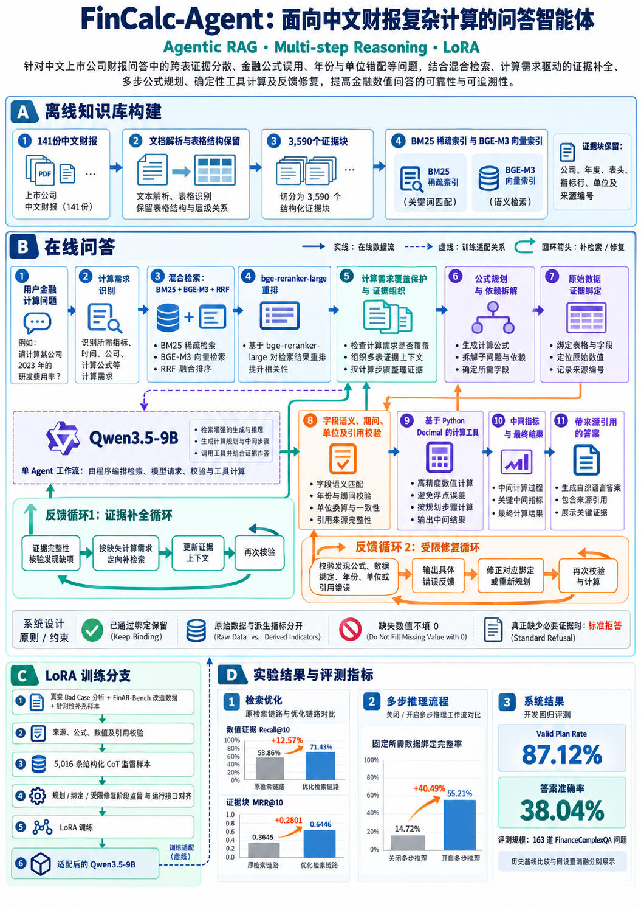

# 架构与依赖

单Agent、程序编排的Plan-and-Execute式工作流。不存在独立规划／证据／复核多Agent服务。

| 阶段 | 核心模块 | 输入／输出 |
|---|---|---|
| 文档解析 | parse_latex.py、table_structure.py | LaTeX→章节、表格、出处 |
| 切块 | chunk_evidence.py | 章节与表格→保留表头的证据块 |
| 初检索 | hybrid_retrieval.py、bge_m3_encoder.py | 问题→BM25、dense、RRF候选 |
| 重排与覆盖 | rerank_context.py、evidence_rerank_v49.py | 候选→覆盖计算需求的排序 |
| 上下文 | select_context_v4.py、table_delivery_v48.py | 证据→带引用编号的视图 |
| 规划 | field_plan_v4.py、plan_contract_v4.py | 问题→公式与输入依赖 |
| 绑定／修复 | agent_v4.py、evidence_prompt_v4.py | 每个输入→value/unit/source_ref/quote |
| 数值与语义 | financial_semantics_v4.py、expression_contract_v4.py | 绑定与表达式→类型化计算 |
| 调度／续评 | eval_execution.py、exact_cpu_cache.py | 固定指纹→有序落盘、断点恢复 |
| 评测 | evaluate_v48.py、trajectory_metrics.py | 输出与独立标签→统计 |

所有命令从仓库根目录执行；保留src/rag与src/eval的历史裸导入，入口脚本设置本地模块路径。
[机器可读依赖图](dependencies.json)列出每个Python文件的本地导入，不依赖个人电脑的绝对路径。

## 训练与服务

`train_lora.py`委派到当前BF16 LoRA训练实现。
`train_qlora_qwen35_9b_v2.py`与`v3.py`提供共享的分词、collator和回答位置投影loss；文件名包含qlora不代表当前训练量化基座。
`serve_qwen35_9b_lora_bf16.py`通过环境变量选择模型与adapter，提供兼容请求端点及运行指纹。
训练与检索依赖分别安装，CPU测试不安装GPU训练栈。

## 保持结果的加速

精确重复字段请求、表格解析及术语匹配缓存；精确查询及有序候选重排缓存；两题CPU流水线配合GPU串行生成。
缓存键包含实际输入，续评核对模型、数据和配置指纹。不缩短证据、不跳过校验、不改变推理精度。
